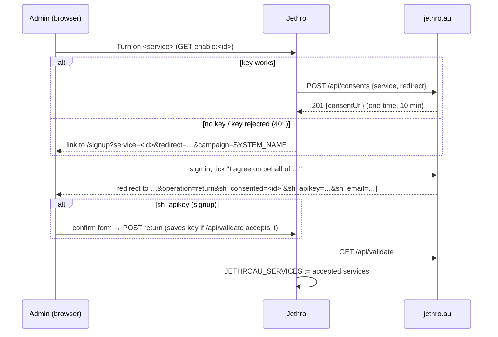
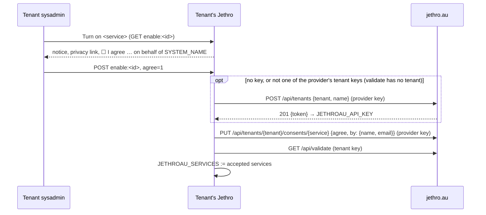

# jethro.au services

[jethro.au](https://jethro.au) runs online services for Jethro installations,
such as the URL shortener ([jethro-url-shortener](https://github.com/jethro-chms/jethro-url-shortener)).
More may follow.

## Model

- **One API key per installation**, in the `JETHROAU_API_KEY` setting. It
  identifies the organisation to every service. jethro.au issues one key per
  signed-in identity (Google, GitHub or emailed link); signing up again with
  the same identity revokes the old key and carries its agreements over.
- **One agreement per service.** Each service has its own privacy terms. A
  person signs in on jethro.au and agrees to a service's terms on behalf of
  the organisation; jethro.au records who agreed, when, and which version of
  the terms, on the key. Services refuse a `create` key without an agreement
  in a version jethro.au still accepts (`403 consent_required` /
  `consent_outdated`).
- **jethro.au is the record.** Jethro mirrors the services the key may use
  in the hidden `JETHROAU_SERVICES` setting (comma-separated ids) so that
  composing an SMS needs no request to jethro.au. The mirror is rewritten
  from `GET /api/validate`'s `services` map whenever the status panel is
  shown and after every change made through it.

Nothing in Jethro stores consent on its own say-so: a return from jethro.au
with `?sh_consented=<id>` only triggers a re-read of `/api/validate`.

## Code

| Piece | Role |
|---|---|
| `include/jethroau.php` (`JethroAu`) | `BASE`; `services()` (the registry below); `serviceEnabled($id)` (key set + id in `JETHROAU_SERVICES` + available in conf.php); `enabledServices()` / `saveEnabledServices()` (the mirror); `acceptedServices()` (validate response → ids); account API calls `validate()`, `consentUrl()`, `signupUrl()`, `withdrawConsent()`, `revoke()`. |
| `calls/call_admin_statuspanel_jethroau.class.php` | Status panel on the `JETHROAU_API_KEY` row (heading *jethro.au Services*): key status, one line per service, refreshes the mirror. |
| `calls/call_admin_statuspanel_operation_jethroau.class.php` | Operations: `enable:<id>`, `disable:<id>`, `return`, `manual`, `deregister`. |
| `Jethro\Sms\renderShortenUrlsToggle()`, `sendSms()`, `makeStatuslineConfig()` | Use `JethroAu::serviceEnabled('url-shortener')`. |

`JethroAu::services()` entries: `name` (what the admin enables),
`available` (conf.php allows it, e.g. `urlShortenerConfig()['supported']`),
`unavailable` (HTML: how to fix),
`notice` (plain text: what using it shares), `privacy` (policy URL),
`enabled` (sentence shown after enabling).

## Flows

- **Signup returns a key** on the query string, so the return page only shows
  a confirmation form; its POST (covered by the request-origin check) saves
  the key, and only if `/api/validate` accepts it.
- **Turn off** (`disable:<id>`) calls `DELETE /api/consents/<id>` and removes
  the id from the mirror even if jethro.au can't be reached.
- **Deregister** calls `DELETE /api/keys/mine` (which also scrubs the
  organisation's name from its short URLs), then blanks both settings.
- **Enter a key** saves a pasted key if `/api/validate` accepts it, turning on
  whatever it has agreed to. Not offered on provider-managed sites.

The panel's details show *On (terms agreed by … on …)*, *Off*,
*terms updated since: please review* (agreed version accepted but not
current; operation **Review … terms** re-runs `enable:<id>`), or *terms have
changed, and need agreeing to again* (agreed version no longer accepted).

## Hosting providers

A provider running many Jethro sites sets `JETHROAU_PROVIDER_KEY` (a
`provider` key issued by the jethro.au operator) in the shared conf.php, and
optionally `JETHROAU_TENANT` per site (default: `BASE_URL`'s host, else the
database name; `JethroAu::tenantId()`). Never a shared `JETHROAU_API_KEY`:
agreements belong to the key, so every site would share them.

With a provider key, **Turn on** never leaves Jethro:

jethro.au records the agreement with the sysadmin's name and email from their
Jethro account, marked as vouched for by the provider. Self-service keys can't
be vouched for: their agreements always need a jethro.au sign-in. Each tenant
key keeps its own agreements, rate limit and attribution; asking for a key for
a tenant that has one replaces it, keeping its agreements.

## jethro.au account API

Served by the URL shortener Worker; other jethro.au Workers check keys
through a service binding to it (`GET /api/authorize?service=<id>`).

| Endpoint | Use |
|---|---|
| `GET /signup?service=&redirect=&campaign=` | Sign in and agree; returns `sh_apikey`, `sh_email`, `sh_consented` |
| `POST /api/consents` `{service, redirect}` | One-time consent page URL for an existing key |
| `GET /consent?ticket=` | Sign in and agree; returns `sh_consented` |
| `DELETE /api/consents/{service}` | Withdraw an agreement |
| `GET /api/validate` | Key details, plus `services: {id: {name, consented, accepted, current, version, by, at, privacyUrl}}` |
| `GET /api/authorize?service=` | 200, or 401 / 403 `consent_required` / `consent_outdated` |
| `DELETE /api/keys/mine` | Revoke the key |
| `POST /api/tenants` `{tenant, name}` (provider key) | Get a tenant a key (replacing any it has, agreements kept) |
| `PUT /api/tenants/{tenant}/consents/{service}` `{agree, by}` (provider key) | Record a tenant sysadmin's agreement |
| `DELETE /api/tenants/{tenant}/consents/{service}`, `GET /api/tenants`, `DELETE /api/tenants/{tenant}` (provider key) | Withdraw, list tenants, revoke a tenant's key |

## Adding a service

1. jethro.au: add it to the account Worker's `SERVICES` registry with its
   privacy page, and have its Worker call `/api/authorize`.
2. Jethro: add an entry to `JethroAu::services()`, gate the feature on
   `JethroAu::serviceEnabled('<id>')`, and document it in
   `docs/jethrosettings.json`'s `JETHROAU_API_KEY` entry.

## Tests

`tests/unit/test_jethroau.php` covers which validate responses enable a
service. The URL shortening functional test
(`tests/functional/sms/sms-url-shortening-preview.conf`) defines
`JETHROAU_API_KEY` and `JETHROAU_SERVICES` directly.
